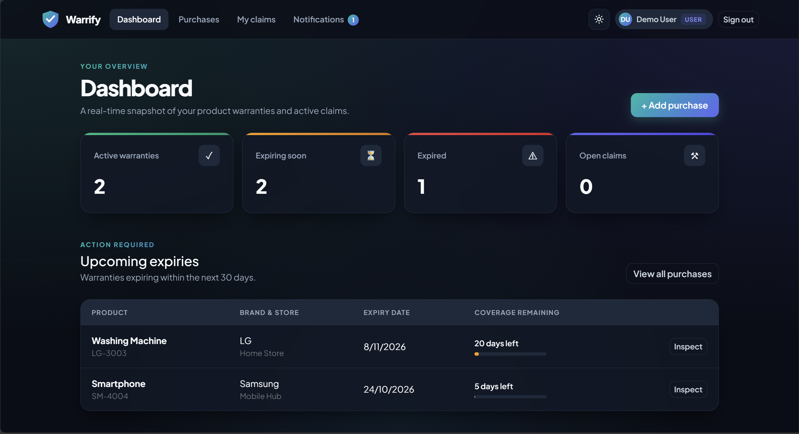
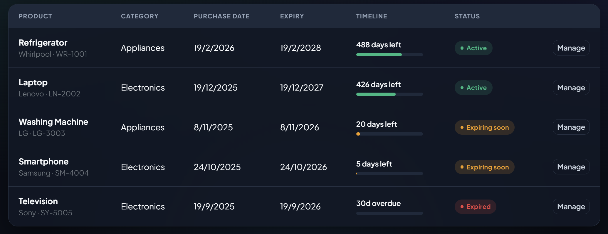
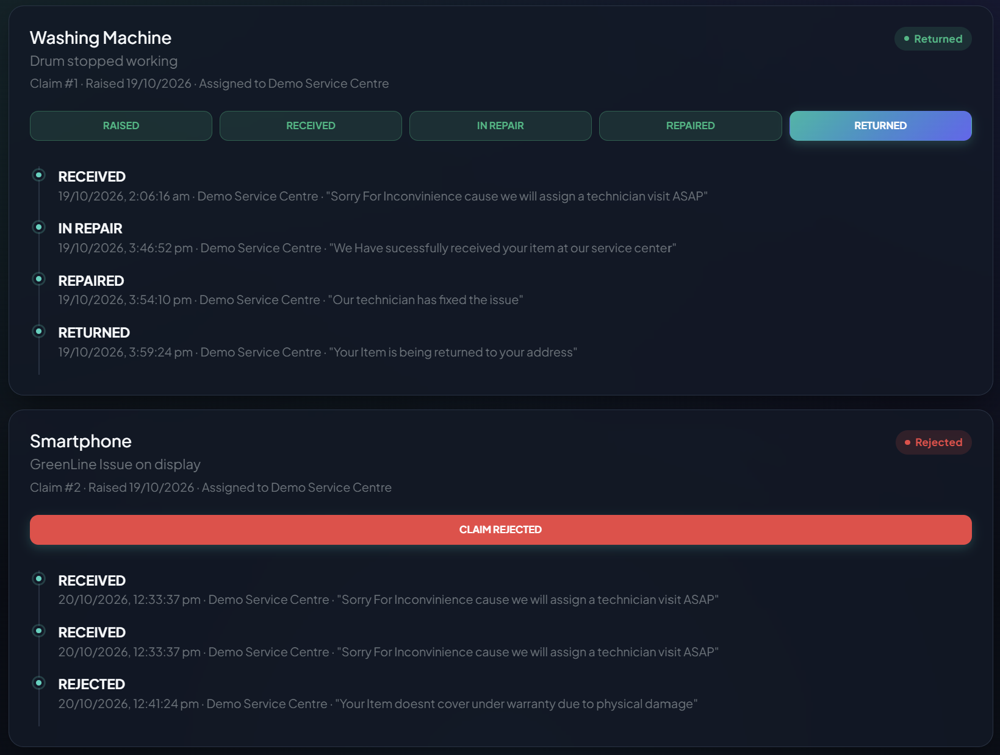
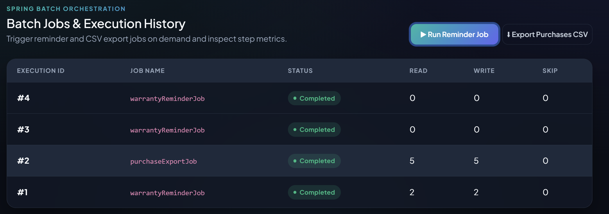
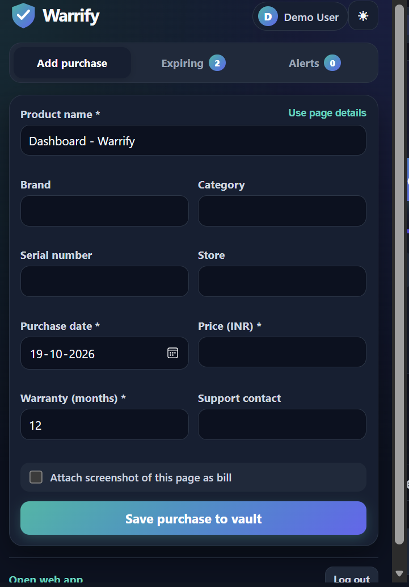

#  Warrify

**Warrify** is a Java 17 / Spring Boot application for storing purchase bills, tracking warranty expiry, sending reminders, and managing service claims. It ships with a static web UI and a Chrome extension that works as a second client of the same API.

Built as a course project for **Server-Side Programming (Spring Framework)** at VIT.

## Features

- **Purchase vault**: add, edit, search and filter purchases; upload and download bills (PDF, JPG, PNG).
- **Expiry reminders**: a scheduled Spring Batch job sends 30-day and 7-day reminders through a JMS queue. Each reminder is sent only once.
- **Claim workflow**: users raise claims, admins assign a service centre, and the service centre moves each claim through `RAISED → RECEIVED → IN_REPAIR → REPAIRED → RETURNED` (or `REJECTED`), with full history.
- **Notifications**: in-app reminders and claim updates, with an unread count.
- **Roles**: User, Admin and Service centre, enforced with Spring Security.
- **SOAP lookup**: get the warranty status for a serial number through a published WSDL.
- **Batch jobs**: CSV import (with row validation and skipping), CSV export, and job history for admins.
- **Chrome extension**: add purchases from any web page, attach a page screenshot as the bill, and get badge counts and desktop alerts.

## Tech stack

| Layer | Technology |
| --- | --- |
| Language / build | Java 17, Maven (wrapper included) |
| Framework | Spring Boot 3, Spring MVC (REST, JSON) |
| Web services | Spring Web Services (SOAP, WSDL, JAXB) |
| Security | Spring Security (session login for the web app, bearer tokens for the extension), BCrypt |
| Persistence | Spring Data JPA, Hibernate, MySQL 8 |
| Messaging | JMS with embedded ActiveMQ Artemis |
| Batch / scheduling | Spring Batch, `@Scheduled` |
| Front end | HTML, CSS, vanilla JavaScript, Bootstrap 5 |
| Extension | Chrome Extension, Manifest V3 |
| Testing | JUnit 5, Mockito, H2 (test scope only) |

## Architecture

```
Web app (HTML/JS)  ──session──┐
                              ├──► Spring Boot ──► Controllers / SOAP endpoint
Chrome extension  ──token─────┘                    ├─ Services ── Repositories (JPA) ──► MySQL
                                                   ├─ Spring Security
                                                   ├─ Spring Batch + scheduler
                                                   └─ JMS producers/listeners ──► Artemis queues
```

## Project structure

```
Warranty Tracker/
├── src/main/java/com/vault/
│   ├── config/        Security, SOAP, JMS, batch, data seeder
│   ├── controller/    REST controllers
│   ├── dto/           Request/response objects
│   ├── entity/        JPA entities
│   ├── repository/    Spring Data repositories, specifications, projections
│   ├── service/       Business logic
│   ├── soap/          SOAP endpoint, client, JAXB classes
│   ├── messaging/     JMS producers and listeners
│   ├── scheduler/     Reminder scheduler
│   └── exception/     Custom exceptions and global handler
├── src/main/resources/
│   ├── static/        Web UI (HTML, CSS, JS, images)
│   ├── xsd/           SOAP schema
│   └── application.properties
├── src/test/java/     Unit and integration tests
├── chrome-extension/  Manifest V3 extension
└── pom.xml
```

## Requirements

- JDK 17
- MySQL 8
- Internet access for the first Maven wrapper build
- No global Maven installation is needed

## Quick start

1. **Start MySQL 8.** The default connection in `src/main/resources/application.properties` uses database `warranty_vault`, username `root` and password `root`. Change these to match your installation. `createDatabaseIfNotExist=true` creates the database, and Hibernate updates the schema.

2. **Run the app.** In Windows PowerShell:

   ```powershell
   $env:JAVA_HOME = 'C:\Program Files\Java\jdk-17'
   .\mvnw.cmd spring-boot:run
   ```

   On macOS or Linux:

   ```sh
   ./mvnw spring-boot:run
   ```

3. **Open** <http://localhost:8080> and sign in with a demo account. The embedded Artemis broker starts with the app, so no external broker is needed.

### Resetting an older database

The ORM changes add required `updated_at` columns and a notification discriminator. If you have a database from an older version, reset it (this deletes all data in `warranty_vault`):

```powershell
mysql -u root -proot -e "DROP DATABASE IF EXISTS warranty_vault; CREATE DATABASE warranty_vault;"
```

If `mysql` isn't on your `PATH`, use the full path:

```powershell
& "C:\Program Files\MySQL\MySQL Server 8.4\bin\mysql.exe" -u root -proot -e "DROP DATABASE IF EXISTS warranty_vault; CREATE DATABASE warranty_vault;"
```

On the next startup, `DataSeeder` recreates the demo accounts and purchases.

## Demo accounts

Created only when the users table is empty:

| Role | Email | Password |
| --- | --- | --- |
| Admin | `admin@vault.com` | `admin123` |
| Service centre | `service@vault.com` | `service123` |
| User | `user@vault.com` | `user123` |

### Demo purchases

Prices are stored as INR amounts and shown with Indian formatting (`en-IN`). On startup, the seeder refreshes these five prices for matching serial numbers owned by `user@vault.com`. It does not change any other purchases.

| Product | Serial number | Sample price | Notes |
| --- | --- | ---: | --- |
| Whirlpool refrigerator | `WR-1001` | ₹34,990 | Active; used in the SOAP example |
| Lenovo laptop | | ₹64,990 | |
| LG washing machine | `LG-3003` | ₹28,990 | Expires in about 20 days |
| Samsung smartphone | `SM-4004` | ₹24,999 | Expires in about 5 days |
| Sony television | | ₹54,990 | |

## Demo walkthrough

1. Sign in as **user**, add a purchase, upload a bill and raise a claim.
2. Sign in as **admin**, assign the claim to the service centre, and run the reminder job from **Batch Jobs**.
3. Sign in as **service centre** and move the claim through each status to `RETURNED`.
4. Sign in as **user** again and check the claim timeline and **Notifications**.

## Reminders

The reminder job runs daily at 09:00 (`vault.scheduler.cron=0 0 9 * * *`). For a demo, either click **Run reminder job** on the admin page, or set:

```properties
vault.scheduler.cron=0 * * * * *
```

Then restart the app so the job runs every minute. Restore the daily schedule afterwards. Per-purchase 30-day and 7-day flags prevent duplicate reminders.

The job reads candidates with a cursor reader, so updating reminder flags doesn't change the rows being iterated. Messages go through the configured JMS template, so `ReminderListener` receives them with the same message conversion.

## SOAP warranty lookup

The WSDL is at <http://localhost:8080/ws/warranty.wsdl>. The operation takes a serial number and returns the product, brand, expiry date, days remaining and status. Example in PowerShell:

```powershell
$soap = @'
<?xml version="1.0" encoding="utf-8"?>
<soap:Envelope xmlns:soap="http://schemas.xmlsoap.org/soap/envelope/" xmlns:w="http://vault.com/ws/warranty">
  <soap:Header />
  <soap:Body>
    <w:GetWarrantyStatusRequest><w:serialNumber>WR-1001</w:serialNumber></w:GetWarrantyStatusRequest>
  </soap:Body>
</soap:Envelope>
'@
Invoke-WebRequest -Uri http://localhost:8080/ws -Method Post `
  -ContentType 'text/xml; charset=utf-8' -Body $soap
```

## CSV import and export

The Purchases page accepts a CSV with this header. Dates use `yyyy-MM-dd`:

```text
productName,brand,category,serialNumber,storeName,purchaseDate,price,warrantyMonths,supportContact
Gaming Monitor,LG,Electronics,MON-101,TechStore,2025-05-10,18999,24,support@lg.com
```

Each row is validated. The response shows how many rows were imported and skipped. Admins can export all purchases as CSV from **Batch Jobs**, where the executions table shows each job's status and read, write and skip counts.

## Validation and ORM notes

- Purchase creation and update use separate validation groups.
- Custom constraints require a purchase date from 2000-01-01 to today, and a warranty of 1–120 months.
- Validation errors include a `fields` object so the UI can show messages under each input.
- Entities inherit `createdAt` and `updatedAt` from `BaseEntity`.
- Notifications use one table with a discriminator for expiry and claim types.
- Purchase search uses JPA specifications. Summary and admin views use projections and aggregate queries, with in-memory caching for dashboard counts.

## Chrome extension

The Manifest V3 extension is a second client for the same API. It only works while the back end is running (default `http://localhost:8080`).

**Install:**

1. Open `chrome://extensions` and turn on **Developer mode**.
2. Click **Load unpacked** and select the `chrome-extension/` folder.
3. Open Warrify from the toolbar and sign in with a **User** account. Use **Server settings** if the back end runs on a different address.

**Features:**

- **Add purchase**, with auto-detected product and store details and an optional screenshot of the visible page as the bill. The price field is in INR.
- **Expiring soon** list.
- **Notifications** with **Mark read** and **Mark all read**.
- Theme switching, demo-credential autofill and a server connection test.
- Checks for new notifications on sign-in, when the popup opens, at browser startup and every minute while Chrome runs. It updates the badge and shows desktop alerts for new unread notifications.

**Authentication:** the extension gets a bearer token from `POST /api/auth/token`. The server stores only a SHA-256 hash of each token, and logging out revokes it. Session login for the web app works as before.

## Build and tests

```powershell
.\mvnw.cmd clean package
```

Tests cover warranty expiry calculation, claim status transitions, scheduler windows, custom validation, search specifications, batch reminder selection and CSV import counts, SOAP endpoint and WSDL behaviour, and Spring context loading. H2 is used only for tests; the app itself uses MySQL.

## Import into Eclipse

1. Choose **File → Import → Maven → Existing Maven Projects**.
2. Select the folder containing `pom.xml` and click **Finish**.
3. Set the project JRE to JDK 17 if Eclipse doesn't pick it automatically.
4. Run `WarrantyVaultApplication` as a Java Application (or Spring Boot App with Spring Tools).

## Screenshots

Add screenshots to `docs/screenshots/` and link them here:

| Dashboard | Purchases | Claim timeline |
| --- | --- | --- |
|  |  |  |

| Admin batch jobs | Extension popup |
| --- | --- |
|  |  |

## Git setup

`.gitignore` excludes build output, uploaded bills, local Maven caches, exported CSV files, environment files and logs. Commit the Maven wrapper files and the Warrify brand assets.

To push to a new remote repository:

```powershell
git remote add origin <repository-url>
git add .
git commit -m "Prepare Warrify project"
git branch -M main
git push -u origin main
```

If Git reports "dubious ownership" for the folder:

```powershell
git config --global --add safe.directory 'E:/Warranty Tracker'
```
